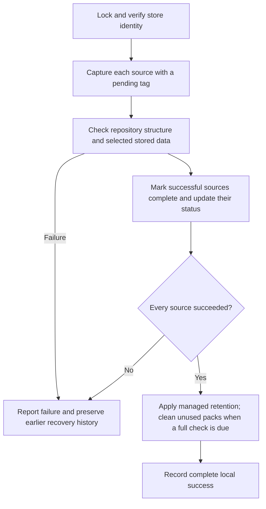

# Architecture

The toolkit keeps backup storage, arbitrary-path materialization, mail access/review tracking, installation, and health reporting as separate responsibilities. Sharing a repository does not make the commands dependencies of each other.

The [storage decision](adr-001-storage.md), [materializer decision](adr-002-materializer.md), and [request-ahead decision](adr-003-download-ahead.md) record why the major choices were made. This document owns current component boundaries and integrity guarantees. [Operations](operations.md) owns procedures, while [Validation](validation.md) owns test coverage and release readiness.

The [mail decision](adr-004-mail.md) defines the optional Himalaya companion. [Mail](mail.md) owns its configuration, operations, read-only command surface, and local review contract.

## Design rules

- Restic owns snapshot storage, repository integrity, and retention. The Python runner coordinates it but does not reproduce its storage engine.
- `icloud-materialize` owns arbitrary-path metadata inspection and complete local reads. It does not acquire backup configuration, scheduling, retention, or recovery responsibilities.
- Each installed tool must expose useful diagnostics when unrelated components are missing or broken. The watchdog must report a missing or broken backup runner without importing it.
- Himalaya owns mail protocols, MIME, and account authentication. The mail adapter owns allowlisted read operations and private per-message review acknowledgments; fetching is distinct from review.
- Each documentation subject has one owner. Entry points summarize enough to choose a workflow and link to the detailed contract or procedure.

## Responsibilities

| Component | Owns | Delegates |
| --- | --- | --- |
| `icloud-materialize`: result models | Versioned public result and worker-protocol data | Encoding and aggregation to command-line and worker code |
| `icloud-materialize`: command line | Option parsing, help, human/JSON rendering, and signal-handler lifecycle | Worker supervision and public-command execution to the parent supervisor |
| `icloud-materialize`: parent supervisor | Deadlines, signals, worker termination/reaping, and final multi-root aggregation | Supplied-path operations to fresh worker processes |
| `icloud-materialize`: scope worker | Resolve explicit roots, guard broad iCloud traversal, and deduplicate overlapping scope | Resolved roots to operation workers |
| `icloud-materialize`: inventory module | Descriptor-relative traversal, metadata and freshness collection, mount boundaries, and stable inventory keys | Payload verification to the fetch operation |
| `icloud-materialize`: verification module | Space estimates, explicit download requests, coordinated reads, hashing, and file revalidation | Native hydration and coordination to macOS/iCloud |
| `icloud-materialize`: worker operations | Bounded inventory passes, check/fetch success conditions, and per-root result assembly | Final multi-root aggregation to the parent |
| `icloud_backup.py`: `Config` / `load_config` | Validated private configuration and path boundaries | Installation layout to the installer |
| `icloud_backup.py`: `App` | Backup lifecycle, completion state, local locks, engine guards, source health, and safe restore targets | Storage, snapshot selection, verification, and calendar retention to Restic |
| `icloud_mail.py` | Bounded read-only mail commands, version/result checks, stable IMAP receipt identity, and atomic private review state | Protocols, MIME, attachment retrieval, and credentials to Himalaya |
| `install_mail.py` | Independent mail runtime/shortcut, private routing creation, source-owned skill deployment, and private migration copies | Mail behavior to the deployed adapter; account configuration remains external |
| `install.py` | Stable runtime/shortcut, generated launchd jobs, deployment metadata, migration copies, and recovery export | Backup execution to the installed runner |
| `watch.py` | Independent supervision of `status --json` and fallback alerts | Health rules to the runner while it can run |
| Restic | Content reuse, compression, internal repository format, snapshots, integrity checks, restore, and retention | Remote file synchronization to iCloud Drive |
| iCloud Drive | Asynchronous upload and native download-on-read | Local backup success is reported by the runner |

The materializer and backup runner are separate installed programs. `icloud-backup materialize ...` performs an early compatibility check and replaces itself with the known `~/bin/icloud-materialize` companion before loading backup configuration or constructing `App`. A missing companion affects only that explicit subcommand. The JSON schema is owned by [the materializer contract](materializer.md#json-schema-10).

The materializer has no global database or daemon. Its parent does not touch supplied paths; a resolution worker and one worker per deduplicated root perform potentially blocking filesystem operations. The parent runs root workers one at a time. Within a fetch worker, request scheduling can hold a bounded window of per-file iCloud requests while complete coordinated reads remain serial. The verification module owns native requests, space checks, and reads; worker operations owns window scheduling and result aggregation. Parent deadlines and interrupts bound waiting, followed by bounded TERM/KILL reaping. Worker process exit ends its process-local I/O policy even when cleanup cannot run. A timeout cannot revoke requests already handed to an iCloud daemon; see the [materializer contract](materializer.md#verification-mechanics) for the bound.

## Intentional duplication and deployment boundaries

The watchdog's small file-writing and notification fallback is intentional duplication. Importing it from the runner would prevent the watchdog from reporting a broken runner import. Tests exercise that failure boundary. The installer may import the source runner because it is a deployment tool, not an independent monitor.

The backup runner and materializer both set the same native I/O-policy family for different child-process relationships. The runner must set policy before spawning Restic; a standalone materializer process cannot set policy for that later sibling. Sharing this code across the Python and Swift runtimes would add coupling without removing the operational requirement.

`icloud_backup.py` remains one deployed source file. Its configuration, engine adapter, lifecycle, status, and restoration responsibilities are separated by functions and classes, while the installer copies one runner atomically. Splitting it into importable installed modules would be useful only if the installer and watchdog failure model were redesigned around an atomic module set.

Within the Swift target, public result models, parent supervision, root scope, metadata inventory, file verification, and worker orchestration live in separate source files. They compile into one executable and communicate through module-internal types; the command exposes no cross-language library surface.

There are two different repositories: the Git checkout stores application source; the Restic backup store holds recovery data. Neither the local cache nor status is a second complete backup store. See [the ownership map](operations.md#identify-the-active-installation) for exact paths and which copies are authoritative.

## Completion and retention

Every source is captured separately. Missing/empty sources and unreadable files are errors, and only engine exit 0 counts as a successful capture. Healthy sources may still gain checked recovery points when a peer fails, but that cycle skips retention. A pending snapshot is not offered as a completed restore point. Earlier pending snapshots are removed only after checked replacements for the current sources succeed.

The first cycle, a cycle after a recorded failure, and a cycle at least 30 days after the last full check read all stored data. Other cycles check all repository structure plus one of seven data-pack subsets, rotating by UTC date. That sample is not a complete reread and does not necessarily include every newly written pack. Restic additionally verifies data before storing it, and restores use `--verify`. A check failure prevents promotion and retention.

Retention filters on this app's `icloud-backup-v2,complete` tags and groups by original source paths. It must not group by per-run tags, which would prevent old history from expiring. Future-dated completed snapshots beyond a small clock tolerance block retention. Calendar policy details belong to [configuration](configuration.md#retention).

After a full check and successful captures, cleanup uses `prune --max-repack-size 0`, followed by another structural check. It removes wholly unused storage files without repacking shared packs. Obsolete bytes within shared packs can remain, and newly obsolete data can remain until a later cleanup. Revisit this tradeoff if wasted storage becomes significant.

Local `flock` serializes this runner's operations that touch the backup store. It first verifies the registered repository identity with Restic's no-lock mode, so an abandoned exclusive lock cannot prevent safe identification, and then runs ordinary `restic unlock`. That command removes only stale locks. If a later Restic command exits specifically because the repository is locked, the runner repeats ordinary unlock and retries that command once with a three-minute lock wait. An active external Restic process remains protected and makes the operation fail after that bound; the runner never uses `unlock --remove-all` or deletes lock files. Other failures are not retried. Engine children run in their own process group so an interruption or timeout can stop the child. Local JSON state is replaced atomically. A missing or mismatched store identity is an error; ordinary backup runs never initialize a substitute store.

## iCloud and space

Files evicted by iCloud can be downloaded when Restic reads them. Before spawning Restic, the runner explicitly enables the public macOS process I/O policy `IOPOL_TYPE_VFS_MATERIALIZE_DATALESS_FILES` with `IOPOL_MATERIALIZE_DATALESS_FILES_ON`; the child inherits it, and the parent restores its previous policy afterward. The system default can reject cloud-only reads with `EDEADLK` even when file permissions are granted. This policy allows downloads within existing macOS permissions and does not grant additional file access. See Apple's [dataless-file guidance](https://developer.apple.com/documentation/technotes/tn3150-getting-ready-for-data-less-files) and `man getiopolicy_np`.

The explicit repository download operation inventories native cloud-only regular files from `stat.SF_DATALESS`, excluding transient Restic lock files. Before reading data it requires enough immediately free space for their logical sizes plus the configured reserve. `restic check --read-data` then materializes repository contents under the same child-process policy and authenticates all stored data. Every initial candidate must afterward be present, readable, and no longer data-less. This is a point-in-time local guarantee because macOS may evict files again. It neither establishes iCloud upload completion nor changes backup-cycle completion, pending snapshots, or alerts.

That `download` operation remains specific to the configured Restic repository. Its later one-byte readability probe is a postcondition after Restic has authenticated all stored data; it is not the generic materializer's algorithm. `icloud-materialize fetch` instead coordinates and reads every included regular file to EOF. The backup runner keeps its small I/O-policy context manager because a standalone materializer cannot change the policy inherited by a later sibling Restic process.

Directory listing, metadata inspection, and timestamp changes do not request file contents, so no `touch` sweep is used. Finder's Download Now remains an operator fallback. Legacy placeholder handling is documented in [configuration](configuration.md#backup-store-and-sources). Restic stdout is kept separate from stderr for parsing: a successful retry can emit diagnostic warnings before valid JSON. Private command logs preserve both streams, and nonzero exit codes remain failures.

This design assumes iCloud will sync. It does not turn a general sync folder into a transactional remote backup store or verify remote upload completion. One Mac writes; other Macs recover after syncing. iCloud can evict data at its discretion, and the app promises no eviction deadline. Full checks, restores, and some maintenance can download substantial data.

The runner checks immediately free local space and a per-engine-command time limit. These checks can stop work visibly; they do not promise that the next write will fit. Finder may report more available space because it includes reclaimable storage. Recovery needs room for both downloaded backup data and restored files. Failure preserves prior good recovery points according to the completion rules above.

File capture is not an atomic filesystem image or application-consistent export. Live databases and active game worlds may require an application export or a quiet period. Normal source files, intended hidden files, and symlinks are covered subject to configured exclusions.

## Validation boundary

[Validation](validation.md) owns the automated coverage, real iCloud acceptance conditions, observed platform matrix, and release limits. Tests can establish the documented local invariants; they do not establish physical power-loss behavior, remote transactionality, completed iCloud upload, or universal compatibility across macOS releases.
